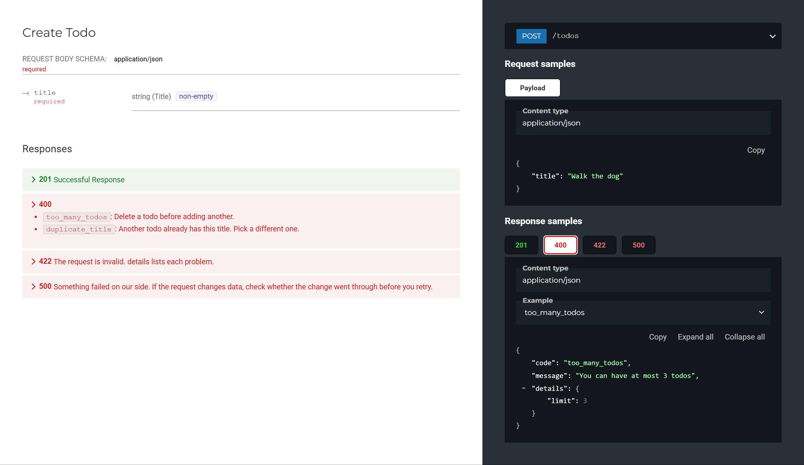

# Documenting FastAPI errors

The code for [How to document error responses in FastAPI](https://dev.to/nimaxin/how-to-document-error-responses-in-fastapi-48a7), a step by step guide to giving every error a FastAPI app returns one shape, and to making its OpenAPI schema list exactly which errors each route can return.



## Run it

You need [uv](https://docs.astral.sh/uv/).

```bash
git clone https://github.com/nimaxin/fastapi-error-responses
cd fastapi-error-responses
uv run fastapi dev steps/step15/main.py
```

Then open http://127.0.0.1:8000/redoc or http://127.0.0.1:8000/docs.

## The steps

The example is a small todo API with two routes, `POST /todos` and `GET /todos/{todo_id}`. Each folder in `steps/` is the API as it stands after that step of the guide, and runs the same way. Steps 6 and 10 change no code, so they have no folder.

| Folder                 | Step                                           |
| ---------------------- | ---------------------------------------------- |
| [step00](steps/step00) | The API before any work on its errors          |
| [step01](steps/step01) | 1. Give the client something to branch on      |
| [step02](steps/step02) | 2. Own the shape of the response               |
| [step03](steps/step03) | 3. Stop repeating yourself at every raise site |
| [step04](steps/step04) | 4. Name the codes in one place                 |
| [step05](steps/step05) | 5. The failures you did not write              |
| [step07](steps/step07) | 7. Declare the errors on the route             |
| [step08](steps/step08) | 8. Pin each code to one value                  |
| [step09](steps/step09) | 9. A helper for the `responses` argument       |
| [step11](steps/step11) | 11. Type the details                           |
| [step12](steps/step12) | 12. Build the message from the details         |
| [step13](steps/step13) | 13. The 500 that nobody documents              |
| [step14](steps/step14) | 14. The 422 that still has its own shape       |
| [step15](steps/step15) | 15. The test that keeps it true                |

## Try each error

The API starts with two todos and allows three. With the app running:

```bash
add() { curl -i localhost:8000/todos -H "content-type: application/json" -d "$1"; }

curl -i localhost:8000/todos/99      # todo_not_found
curl -i localhost:8000/todos/abc     # validation_error, in the path
add '{"title": ""}'                  # validation_error, in the body
add '{"title": "Buy milk"}'          # duplicate_title
add '{"title": "Water the plants"}'  # works, the third todo
add '{"title": "Read a book"}'       # too_many_todos
curl -i localhost:8000/nowhere       # http_error
```

## Tests

```bash
uv run pytest
```

This runs the tests from step 15 against the finished API.

## How the article is built

`article/article.md` is built from `article/template.md`, so every snippet in it matches a file in `steps/` and every response in it comes from running that step:

```bash
uv run python article/build_steps.py    # writes steps/ and article/variants/
uv run python article/run_steps.py      # runs every step and keeps its answers
uv run python article/build_article.py  # writes article/article.md
uv run --no-project --with playwright python article/take_screenshots.py
```

`article/variants/` holds the in-between states the article shows, such as step 15 with an error left out of the schema.
